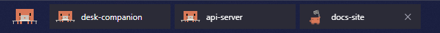
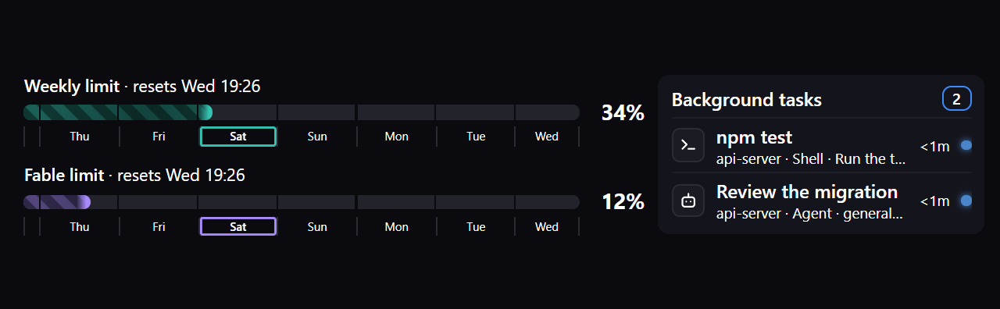

# desk-companion for the Windows taskbar

A small program that puts Clawd in the left corner of your Windows 11 taskbar, with a chip for each of your Claude Code sessions next to him. He sits at his laptop while any session works and idles otherwise; each chip has its own little Clawd acting out its session, like on the phone. Rest the pointer on the corner's Clawd and your limits and every session's background tasks open above him.





It needs desk-companion **0.14.6 or later** with its server running. The program never starts the server. To have the server running from the moment you log in, run `node bin/autostart.mjs --install` in the plugin's folder (see the main [README](../README.md)).

## Set it up

1. Turn off Widgets: Settings → Personalization → Taskbar → Widgets. They sit in the same corner.
2. Unzip `DeskCompanionTaskbar-<version>.zip` anywhere and run `DeskCompanionTaskbar.exe`. Clawd appears in the taskbar.
3. Right-click Clawd and choose **Start with Windows**, so he is there after every login.

It needs the WebView2 runtime, which Windows 11 already has.

## Using it

- **Hover:** rest the pointer on Clawd for a moment and the popup opens above him: your limits on the left, every session's background tasks on the right (a limit your plan doesn't have, like the 5-hour one on Ultra, is left out). It closes about a second after the pointer leaves.
- **Click:** pins the dashboard open. Click again, or click into it and press **Esc**, to close it.
- **Click a session's chip:** opens that session in the Claude desktop app (sessions in a terminal get a chip too, but can't be opened this way). When more sessions are open than fit, the last chip says "+N".
- **✕ on a chip:** shows once its session is done or idle. Click it to clear the chip; the session comes back when you next prompt it or restart it.
- **Right-click** (Clawd or a chip): Pin, Start with Windows, Quit.
- He hides while a full-screen app is up, and when the taskbar is set to hide itself.
- With the taskbar's icons aligned left, Clawd sits next to the tray instead.
- If the port in `config.json` changes, he follows it.

The transparent corner lets clicks fall through to the taskbar, so an invisible window sits over Clawd to catch them. Because of that, he doesn't do his little tap reaction down there.

Start with Windows is a shortcut in your Startup folder. You can also manage it from a terminal: `DeskCompanionTaskbar.exe --install`, `--remove` or `--status`.

## Build from source

You need the .NET SDK 6 or later. From the repo root:

```
dotnet build windows -c Release
powershell -File windows/pack.ps1
```

The second command builds and writes `windows/dist/DeskCompanionTaskbar-<version>.zip`. For testing, set `DESK_COMPANION_HOME` to read the config from another folder.
